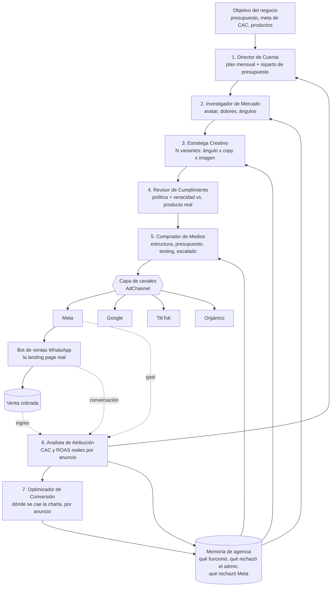

# Agencia de Marketing Automatizada — Arquitectura

**Proyecto:** Agent-Sales-Bot (VentasPro)
**Fecha:** 17 de agosto de 2026
**Alcance:** Meta (FB + IG), Orgánico, Google Ads, TikTok Ads
**Modelo de autonomía:** híbrido por tipo de acción

---

## 1. Diagnóstico: qué hay hoy

No partimos de cero. El proyecto ya tiene tres de las siete piezas de una agencia, pero desconectadas entre sí.

| Pieza existente | Archivo | Qué hace realmente |
|---|---|---|
| Estratega de anuncios | `lib/ad-strategist.ts` (1230 líneas) | Elige una estrategia de una tabla fija `WINNING_STRATEGIES_BY_NICHE` (12 nichos), arma copy con una plantilla PAS fija, genera imagen, guarda borrador, publica en Meta. |
| Agente de crecimiento | `lib/ad-growth-agent.ts` (488 líneas) | Cada 1h protección de gasto, cada 6h revisión de tendencia, cada 15 min freno de tope diario. Propone pausar / subir / bajar por WhatsApp y espera "sí 42". |
| Servicio de canal | `lib/facebook.ts` (1481 líneas) | Marketing API de Meta: campañas, ad sets, insights, presupuestos, catálogo, posts de página. |
| Voz de marca | `lib/brand-voice.ts` | 3 perfiles de tono fijos. |
| Píxel de conversión | `lib/meta-conversions-api.ts` | Solo `sendPurchaseEvent`. |
| Remarketing | `lib/remarketing.ts`, `remarketing-scheduler.ts` | Campañas de email y broadcast de WhatsApp a leads. |
| Registro de decisiones | tabla `ad_agent_logs` | Solo del agente de crecimiento, solo Meta, solo 4 acciones. |

### Las cinco brechas que impiden llamarlo "agencia profesional"

**1. El circuito de atribución está cortado — esta es la brecha crítica.**

El dato existe y se tira. En `lib/whatsapp.ts:554` la función `extraerContextoDeAnuncio()` lee el `externalAdReply` que Meta adjunta al primer mensaje de un click-to-WhatsApp: título del anuncio, cuerpo, URL y `ctwaClid`. Llega hasta `message-handler.ts:156`, se guarda dentro del JSON de `messages.metadata`… y ahí muere. No se copia a `leads` (que solo tiene un campo `source` de texto libre), y por lo tanto nunca se cruza con la tabla `payments` — que sí tiene `leadId`, `conversationId`, `productId` y `amount`, o sea todo lo que hace falta del lado de la venta. Falta exactamente un eslabón.

Consecuencia concreta: **el sistema no sabe cuánto cuesta una venta real.** El agente de crecimiento optimiza contra el "costo por resultado" que reporta Meta — que cuenta conversaciones iniciadas, no plata cobrada. Un anuncio puede traer 50 conversaciones baratas que no compran ninguna y el sistema lo va a escalar.

**2. El "estratega" no investiga: rellena plantillas.**

`WINNING_STRATEGIES_BY_NICHE` es un diccionario escrito a mano. El copy sale de un molde PAS idéntico para todos los productos ("Si no tomas acción hoy, seguirás perdiendo tiempo y dinero…"). El código mismo documenta el desastre que causó: los 29 borradores del nicho "Cursos y Educación" salieron todos con el mismo gancho del MEGAPACK. Existe `ResearchGroundedCopy` para inyectar investigación, pero solo se llena si un humano la trae desde el chat. **No hay memoria de qué ángulo funcionó.**

**3. No hay testing: hay un creativo por producto.**

Un media buyer no lanza un anuncio, lanza 4 ángulos × 2 creativos y deja que los datos maten a los perdedores. Aquí `createDraftAd` produce **un** borrador. `createDraftsForAllProducts` produce uno por producto. No existe la noción de variante, hipótesis, ni criterio de decisión.

**4. Está casado con Meta.**

`AdStrategist` y `AdGrowthAgent` importan `FacebookService` directo y hablan `graph.facebook.com/v21.0` a mano. Agregar TikTok o Google hoy significa duplicar los dos agentes enteros.

**5. Nadie mide el paso post-clic.**

El bot de WhatsApp **es** la landing page de estos anuncios. Si un anuncio trae gente que pregunta el precio y desaparece, el problema puede estar en el anuncio (prometió barato) o en el guion del bot. Hay `response-analytics.ts` y `conversation-metrics.ts` midiendo el bot, y `facebook.ts` midiendo el anuncio — sin un solo `JOIN` entre ellos.

---

## 2. El modelo mental: siete roles, no un agente grande

La tentación es hacer "un agente de marketing más inteligente". Es el diseño equivocado. Una agencia real funciona porque cada rol tiene **un objetivo distinto y en tensión con los demás**: el creativo quiere probar cosas nuevas, el media buyer quiere gastar donde ya funciona, el analista contradice a los dos con datos, y compliance frena a todos. Esa tensión es lo que produce buenas decisiones.

Un solo prompt gigante colapsa esas tensiones en un promedio tibio. Siete roles con insumos y salidas explícitas se pueden auditar, versionar y mejorar por separado.



El bucle que importa es el de abajo: **Analista → Memoria → Investigador/Creativo/Comprador**. Sin él, los siete roles son siete plantillas caras. Con él, el sistema mejora solo.

---

## 3. Ficha de cada rol

### 1. Director de Cuenta — `lib/agency/account-director.ts`

| | |
|---|---|
| **Objetivo** | Repartir un presupuesto finito entre productos para maximizar utilidad, no volumen. |
| **Insumos** | Presupuesto mensual del tenant, catálogo `products` (precio, margen), CAC y ROAS reales del mes anterior (`ad_attribution`), plan anterior. |
| **Salida** | Fila en `ad_plans`: por producto → presupuesto asignado, CAC objetivo, ROAS mínimo, prioridad, y un `reasoning` en texto. |
| **Frecuencia** | Mensual + revisión a mitad de mes si el gasto real se desvía >25% del plan. |
| **Autonomía** | Propone siempre. El plan **requiere aprobación** del admin la primera vez; los reajustes dentro del total ya aprobado se ejecutan solos. |

La regla que evita el error clásico: un producto sin datos suficientes recibe un **presupuesto de exploración fijo y acotado** (ej. 10% del total), no el que "merecería" por una proyección inventada.

### 2. Investigador de Mercado — `lib/agency/market-researcher.ts`

| | |
|---|---|
| **Objetivo** | Producir ángulos que no salgan de un diccionario escrito a mano. |
| **Insumos** | Producto real (nombre, descripción, precio, features), **conversaciones reales** (`messages` de leads con `payments` confirmados de ese producto — qué palabras usan, qué objeciones ponen), ángulos ganadores previos (`agency_memory`), búsqueda web opcional. |
| **Salida** | Fila en `market_research`: avatar, 3–5 dolores citados textualmente de conversaciones reales, 4–6 ángulos con hipótesis, objeciones frecuentes, `valid_until`. |
| **Frecuencia** | Al crear el producto, y cuando la investigación vigente caduca (60 días) o el CAC se degrada >40%. |
| **Autonomía** | Total — no gasta dinero ni publica nada. |

La fuente de oro aquí no es la web: son las conversaciones que el bot ya tuvo. Un dolor citado literal de un cliente que compró vale más que cualquier ángulo generado.

### 3. Estratega Creativo — `lib/agency/creative-strategist.ts`

Reemplaza el `generateAdCopy` de plantilla. Sustituye `WINNING_STRATEGIES_BY_NICHE` como *fallback*, no como fuente primaria.

| | |
|---|---|
| **Objetivo** | Producir **un lote de variantes**, no un anuncio. |
| **Insumos** | `market_research` vigente, `brand-voice.ts`, producto real, creativos ganadores y perdedores previos (`ad_creatives` + `agency_memory`). |
| **Salida** | N filas en `ad_creatives`, cada una con: `angle_id`, hipótesis en una frase, copy (primary/headline/description), prompt e imagen, y el `research_id` que la respalda. |
| **Frecuencia** | Al crear campaña, y cuando el Comprador de Medios pide reposición por fatiga de creativo. |
| **Autonomía** | Total para **generar**. Publicar es del Comprador de Medios y requiere aprobación. |

Regla dura heredada del código actual, que se mantiene: nada de markdown, nada de cifras sin respaldo ("+15.000 alumnos"), nada de promesas que el producto no tiene ("actualizaciones de por vida").

### 4. Revisor de Cumplimiento — `lib/agency/compliance-reviewer.ts`

| | |
|---|---|
| **Objetivo** | Que ningún creativo llegue a la plataforma con algo que la haga rechazarlo o que el cliente pueda reclamar. |
| **Insumos** | Creativo candidato, producto real, políticas por canal, historial de rechazos (`agency_memory` tag `platform_rejection`). |
| **Salida** | Veredicto `pass` / `fix` / `block` + motivo, escrito en `ad_creatives.compliance`. |
| **Frecuencia** | Bloqueante antes de publicar cualquier creativo. |
| **Autonomía** | **Puede bloquear solo.** Nunca puede aprobar por encima de un `block`. |

Chequea tres cosas: política de la plataforma (salud, dinero fácil, "tú"/segmentación personal), **veracidad contra el producto de la base de datos** (si el copy promete 81 cursos, ¿el producto tiene 81 cursos?), y coherencia de precio.

### 5. Comprador de Medios — `lib/agency/media-buyer.ts`

Evoluciona `ad-growth-agent.ts`. Es el único rol que toca dinero.

| | |
|---|---|
| **Objetivo** | Encontrar el ganador rápido y barato, y luego escalarlo sin romperlo. |
| **Insumos** | Plan (`ad_plans`), lote de creativos aprobados, métricas diarias (`ad_daily_metrics`), CAC/ROAS reales (`ad_attribution`), experimentos vivos (`ad_experiments`). |
| **Salida** | Acciones sobre el canal + fila en `agency_decisions`. |
| **Frecuencia** | Protección de gasto cada 1h · tendencia cada 6h · tope diario cada 15 min · lectura de experimentos 1×/día. |
| **Autonomía** | **Híbrida — ver §5.** |

Su lógica de testing, que hoy no existe:

1. **Fase de test.** Un ad set por ángulo, presupuesto igual y acotado, sin público superpuesto. Corre hasta un mínimo de impresiones o de gasto — lo que llegue primero.
2. **Criterio de corte escrito antes de arrancar**, guardado en `ad_experiments.decision_rule`. Si el criterio no está escrito antes, el resultado se racionaliza después. Ese es el error humano que la automatización debe evitar, no reproducir.
3. **Mata perdedores solo.** Apagar un creativo que perdió reduce gasto → no pide permiso.
4. **Escalar pide permiso.** Máximo +20–30% por paso, con un piso de horas entre pasos.
5. **Fatiga.** Si la frecuencia sube y el CTR cae de forma sostenida, le pide reposición al Estratega Creativo en vez de subir presupuesto.

### 6. Analista de Atribución — `lib/agency/attribution-analyst.ts`

**Este rol es la fase 0. Todo lo demás depende de él.**

| | |
|---|---|
| **Objetivo** | Responder "¿cuánto me costó cada venta, por anuncio?" con plata real, no con métricas de plataforma. |
| **Insumos** | Gasto por anuncio (canal), `ad_attribution` (clic → conversación → lead), tabla `payments` (venta cobrada al cliente — **no** `payment_transactions`, que son las suscripciones SaaS del tenant). |
| **Salida** | CAC real, ROAS real, tasa clic→conversación, conversación→venta, y ticket promedio — por anuncio, ad set, campaña, producto y canal. Alimenta `ad_daily_metrics`. |
| **Frecuencia** | Diaria, más consulta bajo demanda. |
| **Autonomía** | Total — solo lee y calcula. |

La cadena de identidad ya tiene todos los eslabones en el código, solo hay que soldarlos:

```
Meta ad_id / ctwa_clid
  → externalAdReply del primer mensaje        (whatsapp.ts:554 — ya se extrae)
  → messages.metadata.adId                    (message-handler.ts:156 — ya se guarda)
  → leads.ad_id  ← FALTA ESTE ESLABÓN, ES EL ÚNICO
  → payments.leadId + payments.amount         (ya existe)
  → venta atribuida al anuncio
```

Nota honesta sobre el modelo: con click-to-WhatsApp la atribución es de **último clic determinista** — no hay ventanas de vista ni multi-touch. Es más pobre que un modelo publicitario completo, y a la vez más confiable, porque no estima nada. Vale la pena decirlo en el reporte para no vender una precisión que no existe.

### 7. Optimizador de Conversión — `lib/agency/conversion-optimizer.ts`

| | |
|---|---|
| **Objetivo** | Separar "el anuncio trae mala gente" de "el bot no cierra". |
| **Insumos** | Conversaciones agrupadas **por anuncio de origen**, `response-analytics.ts`, `objectionHandler.ts`, etapa donde murió cada charla. |
| **Salida** | Diagnóstico por anuncio con una recomendación dirigida a **uno** de los dos lados: al Estratega Creativo (cambiar la promesa del anuncio) o al guion del bot (`agents` / `personality-profiles`). |
| **Frecuencia** | Semanal. |
| **Autonomía** | Recomienda. Cambiar el guion del bot **requiere aprobación** — afecta a todos los clientes, no solo a una campaña. |

El patrón que sale primero, casi seguro: anuncios que insinúan precio bajo → mucha conversación, cero venta, CAC destruido. Hoy el sistema lo lee como "anuncio barato, escalar".

### Memoria de agencia — `lib/agency/agency-memory.ts`

No es un agente: es el sustrato que hace que el sistema aprenda. Se apoya en `architect-memory-service.ts`, que ya existe.

Guarda cuatro clases de hecho, cada una con evidencia y fecha: **ángulos ganadores** (con el CAC que lograron), **ángulos perdedores** (para no repetirlos), **decisiones del admin** (qué aprobó y qué rechazó — `ad-growth-agent.ts` ya hace un esbozo en `recentRejectionNote`), y **rechazos de plataforma**.

---

## 4. Datos y endpoints

### Tablas nuevas

```
ad_plans              plan del Director: mes, producto, presupuesto, CAC objetivo,
                      ROAS mínimo, estado (propuesto/aprobado/activo), reasoning

market_research       investigación por producto: avatar, dolores[], ángulos[],
                      objeciones[], fuentes[], valid_until

ad_creatives          variante: research_id, angle_id, hipótesis, copy, imagen,
                      compliance{veredicto,motivo}, estado, channel

ad_experiments        test: producto, canal, variantes[], decision_rule (escrita
                      ANTES), min_impressions, min_spend, estado, ganador

ad_attribution        clic → venta: channel, ad_id, adset_id, campaign_id,
                      click_id, lead_id, conversation_id, first_touch_at,
                      sale_id, revenue

ad_daily_metrics      snapshot diario por (channel, ad_id, fecha): spend,
                      impressions, clicks, conversations, sales, revenue, cac, roas

agency_decisions      generalización de ad_agent_logs: role, channel, action,
                      autonomy (auto|approval), reason, evidence, status,
                      approved_by, applied_at

agency_memory         hecho aprendido: tipo, alcance, contenido, evidencia,
                      confianza, decay_at
```

### Cambios sobre tablas existentes

- `leads` → agregar `ad_id`, `adset_id`, `campaign_id`, `click_id`, `channel`, `first_touch_at`. **Este es el cambio que cierra el circuito.**
- `facebook_drafts` → renombrar a `ad_drafts` y agregar `channel` (hoy es Meta implícito).
- `ad_agent_logs` → conservar y migrar hacia `agency_decisions`; no romper el historial existente.

### Endpoints — `routes/agency.ts`

```
GET    /api/agency/overview                    tablero: CAC, ROAS, gasto vs. plan
GET    /api/agency/attribution                 ?groupBy=ad|adset|product|channel
GET    /api/agency/plan            POST/PUT    plan mensual + aprobación
GET    /api/agency/research/:productId  POST   investigación (ver / regenerar)
GET    /api/agency/creatives      POST         lote de variantes
POST   /api/agency/creatives/:id/approve
GET    /api/agency/experiments    POST         tests vivos / lanzar test
POST   /api/agency/experiments/:id/decide      forzar decisión
GET    /api/agency/decisions                   bitácora unificada de los 7 roles
POST   /api/agency/decisions/:id/approve|reject
GET    /api/agency/cro/:adId                   diagnóstico post-clic
```

Las rutas actuales de `routes/facebook.ts` (`/strategist/*`, `/agent/*`) se mantienen funcionando y quedan como la implementación Meta detrás de la capa nueva.

### Capa de canales — `lib/agency/channels/`

Todos los roles hablan con esta interfaz, nunca con la API de una plataforma:

```ts
interface AdChannel {
  id: "meta" | "google" | "tiktok" | "organic";
  isConfigured(): boolean;
  createCampaign(spec: CampaignSpec): Promise<ChannelIds>;
  createAdSet(spec: AdSetSpec): Promise<ChannelIds>;
  publishCreative(creative: AdCreative): Promise<ChannelIds>;
  getInsights(range: DateRange, level: "campaign"|"adset"|"ad"): Promise<Insight[]>;
  setBudget(adSetId: string, daily: number): Promise<Result>;
  setStatus(id: string, active: boolean): Promise<Result>;
  policyHints(): PolicyRule[];
}
```

- **`meta.ts`** — envuelve el `FacebookService` que ya existe. Refactor, no reescritura.
- **`organic.ts`** — sin gasto: usa `facebook-page-posts.ts` y `remarketing.ts` que ya están. El Comprador de Medios lo trata como un canal de presupuesto cero, así el orgánico entra en el mismo reporte de atribución.
- **`google.ts`**, **`tiktok.ts`** — integraciones nuevas. Ambas tienen fricción real: Google Ads API exige *developer token* con aprobación manual, y TikTok Marketing API exige app aprobada. Con la interfaz definida, agregarlas es trabajo de plomería, no de rediseño.

---

## 5. Matriz de autonomía híbrida

El principio: **una acción se ejecuta sola si su peor resultado posible es dejar de gastar.** Si su peor resultado es gastar de más, pide aprobación.

### Ejecuta solo — avisa después

| Acción | Guardas obligatorias |
|---|---|
| Pausar anuncio / ad set por rendimiento | ≥ mín. impresiones **y** ≥ mín. gasto **y** ventana ≥ 24h |
| Bajar presupuesto (≤ 30% por paso) | Máx. 1 paso cada 24h sobre el mismo objeto |
| Apagar el creativo perdedor de un test | Solo si `decision_rule` estaba escrita antes de arrancar |
| Freno de tope de gasto diario | Ya existe (`FB_DAILY_SPEND_CAP`) — se conserva tal cual |
| Bloquear un creativo por cumplimiento | Antes de publicar; siempre |
| Pausar por rechazo de la plataforma | Inmediato |
| Investigar, generar creativos, calcular métricas | No tocan dinero |

### Pide aprobación — propone y espera

| Acción | Por qué |
|---|---|
| Subir presupuesto | Gasta más |
| Crear campaña o ad set nuevo | Gasta más |
| Publicar un creativo | Dinero + imagen de marca |
| Reactivar algo pausado | Revierte una protección |
| Cambiar público / objetivo | Reinicia el aprendizaje de la plataforma |
| Aprobar el plan mensual | Define el techo de todo lo demás |
| Cambiar el guion del bot | Afecta a todos los clientes |
| Cualquier cosa que exceda el presupuesto del plan | Techo duro |

### Nunca automático

Conectar o cambiar la cuenta publicitaria · cambiar el tope global de gasto · tocar métodos de pago · publicar en una cuenta que no sea la del tenant (`credencialesFb()` ya protege esto — mantenerlo).

### Frenos globales

- Máximo **N acciones autónomas por día por tenant** (arrancar en 10). Al llegar al tope, todo pasa a requerir aprobación y se avisa.
- **No repetir** la misma acción sobre el mismo objeto dentro de 24h.
- Toda acción autónoma se registra en `agency_decisions` con su evidencia y **se puede revertir con un mensaje** ("deshacer 42").
- **Interruptor de emergencia:** `AGENCY_AUTONOMY=off` deja todo en modo propuesta.

---

## 6. Roadmap por fases

### Fase 0 — Cerrar el circuito de atribución `⭐ empezar aquí`

Sin esto, las seis fases siguientes optimizan a ciegas. Es también la fase más barata: los datos ya se extraen, solo no se guardan donde sirven.

- Agregar `ad_id`, `adset_id`, `campaign_id`, `click_id`, `channel`, `first_touch_at` a `leads`.
- Crear `ad_attribution` y `ad_daily_metrics`.
- Persistir el `externalAdReply` desde `message-handler.ts` hacia `leads` (hoy muere en `messages.metadata`).
- Job diario que cruza gasto ↔ conversaciones ↔ `payments` y llena `ad_daily_metrics`.
- Pantalla de atribución en el dashboard.

**Resultado:** por primera vez sabés cuánto cuesta una venta real, por anuncio.

### Fase 1 — Memoria de agencia
`agency_memory` + `agency_decisions`, migrando `ad_agent_logs`. Alimentada por la Fase 0. Sin memoria no hay aprendizaje, solo repetición.

### Fase 2 — Investigador + Estratega Creativo + Cumplimiento
Las tablas `market_research` y `ad_creatives`. Lotes de variantes en vez de un anuncio. `WINNING_STRATEGIES_BY_NICHE` pasa a ser red de seguridad.

### Fase 3 — Comprador de Medios con testing y autonomía híbrida
`ad_experiments` con `decision_rule` escrita antes. La matriz de §5. Evoluciona `ad-growth-agent.ts` sin borrarlo.

### Fase 4 — Director de Cuenta
`ad_plans`. Reparto de presupuesto entre productos guiado por el CAC real de la Fase 0.

### Fase 5 — Capa de canales
Extraer la interfaz `AdChannel`, envolver Meta, sumar orgánico. Recién después TikTok y Google (ambas con dependencia externa de aprobación de API — conviene arrancar esos trámites en paralelo desde la Fase 0).

### Fase 6 — Optimizador de Conversión
El circuito post-clic. Necesita varias semanas de datos de la Fase 0 acumulados para decir algo con fundamento.

---

## 7. Riesgos y decisiones a tomar

**Volumen de datos.** Con poco gasto diario, muchos anuncios nunca van a alcanzar significancia estadística. El sistema debe **decir "no sé todavía"** en vez de decidir con 40 impresiones. `sampleBasedConfidence()` en `ad-growth-agent.ts` ya tiene la idea correcta; hay que aplicarla en todos los roles.

**Costo de LLM.** Siete roles corriendo seguido es plata. Mitigación: los roles caros (Investigador, Creativo) corren por evento, no por reloj; los baratos (Analista, Comprador) son SQL y aritmética, no modelo. Vale medirlo con `cost-tracker.ts`, que ya existe.

**Multi-tenant.** `credencialesFb()` ya protege contra publicar en la cuenta equivocada. Cada rol nuevo tiene que heredar esa protección desde el primer commit, no después.

**Atribución imperfecta.** Último clic determinista, sin ventana de vista. Es lo honesto que se puede medir con click-to-WhatsApp; conviene mostrarlo así en el reporte.

### Tres decisiones que dependen de vos

1. **Presupuesto de exploración.** ¿Qué porcentaje del total puede gastar el sistema en probar productos sin historial? Sugerencia: 10–20%.
2. **Umbral mínimo de decisión.** ¿Cuántas ventas atribuidas hacen falta antes de escalar un anuncio? Sugerencia: 3, y nunca menos de 2.
3. **Cuánto ruido tolerás en WhatsApp.** Hoy toda sugerencia va por mensaje. Con siete roles eso se vuelve spam. Sugerencia: solo lo urgente (freno de gasto, rechazos, aprobaciones que bloquean) por WhatsApp; el resto en un resumen diario y en el dashboard.

---

## 8. Resumen en una página

| | Hoy | Con esta arquitectura |
|---|---|---|
| **Estrategia** | Diccionario de 13 nichos escrito a mano | Investigación por producto, anclada en conversaciones reales de clientes que compraron |
| **Creativos** | 1 anuncio, plantilla PAS fija | Lote de variantes por ángulo, con hipótesis y linaje |
| **Testing** | No existe | Experimentos con criterio de corte escrito antes de arrancar |
| **Métrica de decisión** | Costo por resultado que reporta Meta | CAC y ROAS reales, con plata cobrada |
| **Aprendizaje** | Ninguno (cada corrida arranca de cero) | Memoria de ángulos ganadores, perdedores y decisiones del admin |
| **Canales** | Meta cableado en el código | Interfaz `AdChannel` — Meta, orgánico, Google, TikTok |
| **Autonomía** | Todo pide permiso salvo el tope de gasto | Híbrida: ejecuta lo que reduce gasto, consulta lo que lo aumenta |
| **Post-clic** | Sin medir | El bot medido como landing page, por anuncio |
